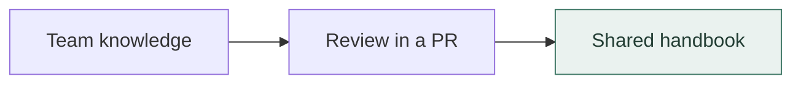

# Dev Wiki

**Team knowledge. One Git repo.**

A plain-Markdown handbook for how your team builds and operates.
Keep policies, runbooks, system guides, and decisions in Git, with owners and review history.

[**Use the template →**](https://github.com/nickdrezza/dev-wiki/generate)
· [Conventions](CONVENTIONS.md)
· [Contribute](CONTRIBUTING.md)

Any text editor works. There is no database or hosted service to run.
Documents are filed by type, with an owner and an updated date.
Optional merge notifications can post the changes to your team chat.

This repo is a template. Make a copy for your team, then replace the example documents.

## Start your team wiki

1. **Create your repo.** Click **“Use this template”** on GitHub (or clone this repo and point
   it at a new remote).
2. **Make it yours.**
   - Keep the license terms in [`LICENSE`](LICENSE). Add copyright notices to [`NOTICE`](NOTICE).
   - Edit this `README.md` to describe *your* team's wiki.
   - Adjust the folder set and tie-breakers in [`CONVENTIONS.md`](CONVENTIONS.md) if your team
     files things differently — the structure is a strong default, not a cage.
3. **Clear the examples.** Delete the sample docs in each folder (keep each folder's
   `README.md` index), reset [`CHANGELOG.md`](CHANGELOG.md), and empty [`GAPS.md`](GAPS.md).
4. **Write your first real doc.** Copy [`_template.md`](_template.md) into the right folder,
   fill in the frontmatter, add it to the folder index, and add a `CHANGELOG.md` bullet.
5. **(Optional) Turn on merge notifications.** Add a `CHAT_WEBHOOK_URL` secret — see
   [`meta/chat-merge-notifications.md`](meta/chat-merge-notifications.md).

## How it's organized

Documents are filed by **what they are**, not by topic. Pick the folder that matches:

| Folder | What lives here | Read it to… |
|---|---|---|
| [`policies/`](policies/) | The rules — standards the team must follow | know the rule |
| [`guides/`](guides/) | How-to instructions & onboarding | learn to do a task |
| [`systems/`](systems/) | Reference docs for the systems you run | understand how something works |
| [`runbooks/`](runbooks/) | What to do when something breaks, and routine ops | operate / recover |
| [`references/`](references/) | Glossary, conventions, cheat-sheets, links | look something up |
| [`decisions/`](decisions/) | ADRs — why you chose what you chose | understand a past decision |
| [`incidents/`](incidents/) | Post-mortems & investigations — what broke and what you learned | learn from a past incident |

[`meta/`](meta/) documents the wiki itself (tooling, conventions).
[`notebooks/`](notebooks/) is personal scratch space — one folder per person, no template or
review bar. [`GAPS.md`](GAPS.md) tracks open questions not yet documented.

**Not sure where something goes?** policy = the rule, guide = the steps to comply.
guide = build/learn, runbook = operate/recover under pressure.

## Contributing

The short version: put the doc in the right folder, start from [`_template.md`](_template.md),
add it to the folder's `README.md` index, and add a dated bullet to the top of
[`CHANGELOG.md`](CHANGELOG.md) — all in one pull request. Full conventions are in
[`CONVENTIONS.md`](CONVENTIONS.md); the contribution workflow is in
[`CONTRIBUTING.md`](CONTRIBUTING.md).

## Automation

An optional GitHub Action ([`.github/workflows/notify-chat-on-merge.yml`](.github/workflows/notify-chat-on-merge.yml))
posts to a team chat space on every push to `main` — the merge headline, new changelog
bullets, and changed files. It works with any chat provider that accepts an incoming webhook;
set up is one repository secret. See [`meta/chat-merge-notifications.md`](meta/chat-merge-notifications.md).

## Editing in Obsidian (optional)

The repo is plain Markdown, so any editor works. [Obsidian](https://obsidian.md) is a nice
fit — open the repo as a vault for fast search, backlinks, and a file tree. The vault config
(`.obsidian/`) is intentionally **not** committed (see [`.gitignore`](.gitignore)); keep your
editor setup local.

See [`OBSIDIAN.md`](OBSIDIAN.md) for a full setup guide — opening the vault, keeping links
GitHub-compatible, wiring up the doc template, and committing your changes.

## License

This project is licensed under [GNU AGPLv3 only](LICENSE) (`AGPL-3.0-only`).
See [NOTICE](NOTICE) for copyright information.

You can use, change, and sell copies under the license terms.
If you distribute covered code, provide its source under the same license.
If you change the project and let users access it over a network,
offer those users the source of your version.

Earlier releases keep the license terms that applied to them.
